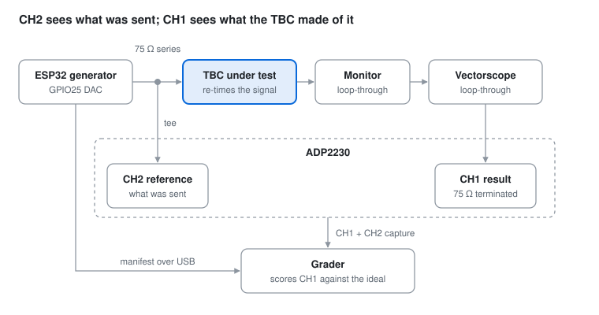
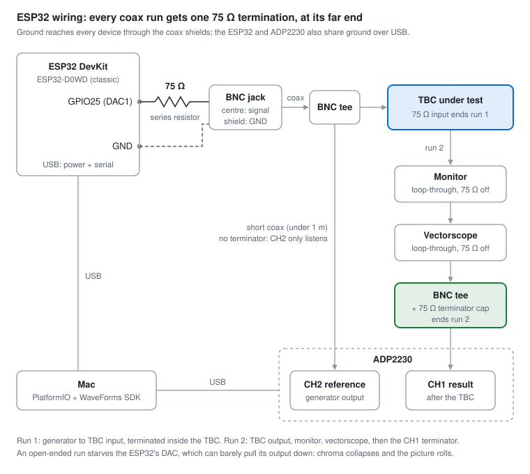
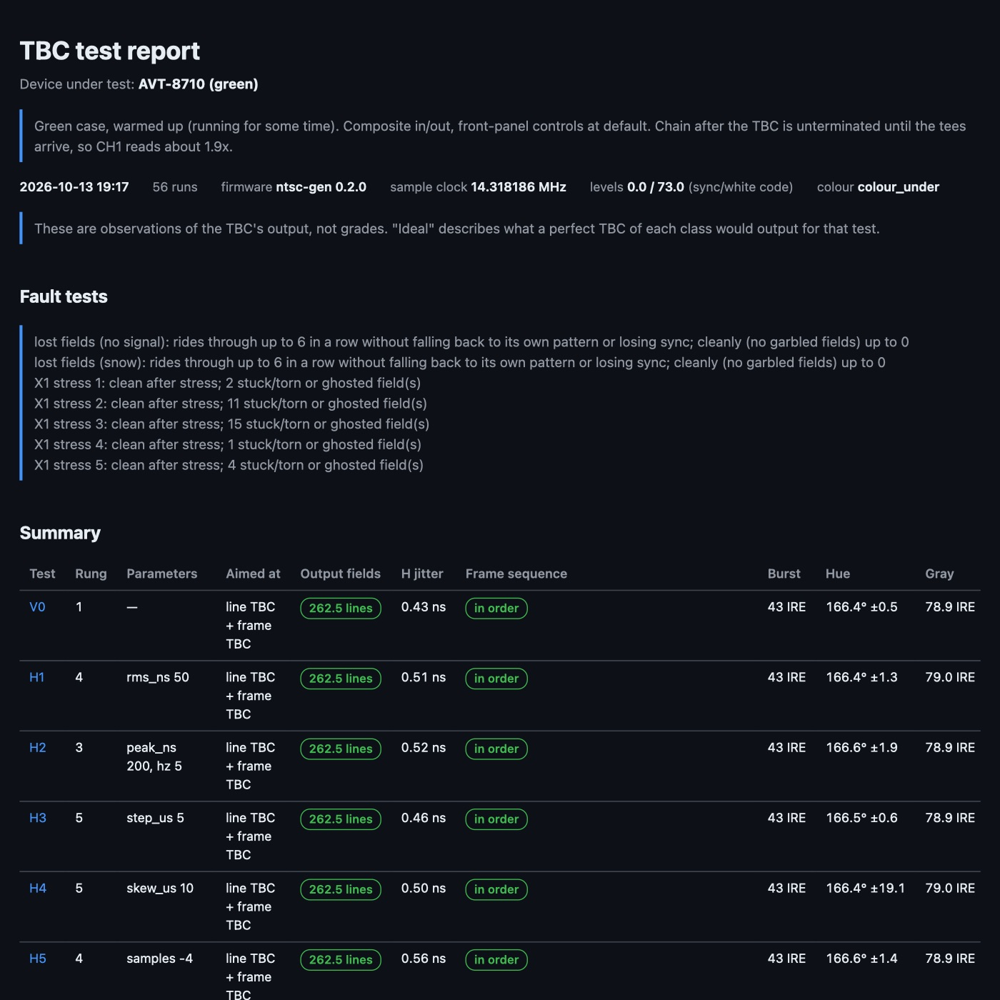

# NTSC Test-Signal Generator (ESP32)

The generator side of a rig for grading **time-base correctors (TBCs) used with
VHS and Betamax**. An ESP32 makes NTSC composite video with precisely
controlled faults. The signal passes through the TBC under test, and an
ADP2230 captures what went in and what came out, so a separate grader can
score how well the TBC repaired it.



The test catalog, scoring approach and grader contract are in
[docs/design.md](docs/design.md).
Measured hardware and toolchain facts (settling times, quirks, pitfalls) are in
[docs/bench-notes.md](docs/bench-notes.md). Read it before changing the tools.
Open work is in [TODO.md](TODO.md).

## Status (2026-10-14)

| Area | State |
|---|---|
| Colour bars, first light | **Done.** SMPTE and EIA bars, staircase, flat, crosshatch. Hue within 1.5° and luma within 0.5 IRE at the DAC |
| Timing tests (H1–H5, F1–F3) | **Built and verified** against the reference model. F1 not yet measured on the scope |
| Structure tests (S1–S9) | **Built and verified**; observed through the TBC on CH1. S4, S8 and S9 target frame synchronisers |
| Colour and level tests (C1–C4, L1–L4) | **Built and verified**; observed through the TBC on CH1, with picture metrics (burst, hue, saturation, level, noise, hum) |
| Fault tests (S10, S11, X1, V1) | **Built and verified.** Lost-field tolerance, a stress-and-recovery fault hunt for buggy units, and a no-signal capture of the TBC's own fallback output |
| Device tagging and reports | **Done.** `--dut`/`--note` on every run; optional `--html` report |
| Colour-under (VHS/Betamax) | **Default.** Direct colour (U-matic/1") available with `chroma follows` |
| Frame marker, manifest, capture runner | **Done.** The marker decodes through the TBC on CH1 and on the CH2 reference |
| CH2 reference | **Done.** Every two-channel run checks its input, measures the TBC's latency and whether its output is locked to the input, and its gain against the real input |
| One-channel rigs | **Supported.** `--channels 1` needs only CH1 (one scope channel, no tee) |
| Still to do | See [TODO.md](TODO.md): generator level and chroma calibration, H6 velocity error, the AVT-8710 fault hunt |
| Grader | Not part of this repo. `tools/perturb_model.py` is its reference for what was sent |

## Wiring



| From | To | Notes |
|---|---|---|
| ESP32 GPIO25 (DAC1) | 75 Ω series resistor → BNC centre | Source resistor; matches the cable, does not terminate it |
| ESP32 GND | BNC shield | |
| BNC tee (run 1) | TBC input | The TBC's 75 Ω input terminates run 1 |
| BNC tee (branch) | ADP2230 **CH2** | Short coax, no terminator; the scope's 1 MΩ input only listens |
| TBC output (run 2) | monitor → vectorscope (loop-through, 75 Ω off) | |
| End of run 2 | BNC tee + 75 Ω terminator → ADP2230 **CH1** | The one termination for run 2 |
| ESP32 USB, ADP2230 USB | Mac | Power, serial control, capture |

**Every coax run needs exactly one 75 Ω termination at its far end.** The
ESP32's DAC can push its output up but barely pull it down, so an open-ended
run turns the 3.58 MHz chroma into a sawtooth (about 4× too small) and the
picture goes dark and rolls.

The default levels (`levels 0 73`) still need calibrating. The target is
286 mV of sync and 714 mV of white above blanking. Measured on CH2 into the
TBC's 75 Ω input: 226 mV of sync (79 %), with chroma and burst about 0.68× of
nominal at 3.58 MHz.

### Minimal rig: one scope channel

Not everyone has a two-channel scope or spare tees. With `--channels 1` (or
`TBC_CHANNELS=1`) the tools capture **CH1 only**:

| From | To |
|---|---|
| ESP32 GPIO25 → 75 Ω series resistor → BNC | TBC input (its 75 Ω input terminates the run) |
| TBC output | scope CH1, with a 75 Ω terminator (a tee, or a monitor's loop-through with termination on) |

Everything still works: every output field is classified, the frame markers
are decoded, and lost-field tolerance, the fault hunt and the dropout watch run
as usual. A single-channel run can't check its own input, can't measure the
TBC's latency, and judges picture levels against nominal values rather than
the generator's real output. Reports label those runs "CH1 only". The dropout
watch only ever uses CH1.

With two channels, a run whose CH2 shows no video says so ("is the reference
connected?") and is otherwise reported as single-channel.

## How it works

- **Signal path.** The classic ESP32 (D0WD) runs I2S0 in LCD/DAC mode and
  streams DMA straight to its 8-bit DAC on GPIO25 at 4 × fsc =
  14.318182 MHz, clocked from the APLL.
- **Two-frame DMA ring.** The ring has two halves, one frame each. An
  end-of-frame interrupt wakes a task that rewrites the half that just finished
  while the other plays (6–9 ms of a 33 ms frame). Sequences never repeat, and
  a half can hold any number of lines (up to 600), so frames can drop fields or
  change line count.
- **Pre-rendered lines.** Each distinct line is rendered once from a model
  (sync, burst, Y/U/V segments with band-limited edges) in up to 8 sub-sample
  shifted copies.
- **Timing faults live in the ring, not the picture.** A descriptor's length
  sets where the next line's sync falls, in 2-sample (140 ns) steps; the
  shifted copies fill in the fine steps (35 ns with 4 copies).
- **Colour-under by default.** Sync, luma and the colour envelopes jitter while
  the 3.58 MHz carrier stays on a continuous reference, as a VHS/Betamax deck
  delivers it.
- **Reproducible.** Every perturbation is a pure function of the absolute line
  number (`src/perturb.cpp`, mirrored by `tools/perturb_model.py`), so the
  grader can rebuild exactly what was sent from the manifest.
- **Frame marker** on lines 24 and 287, the top picture rows. TBCs commonly
  blank the vertical interval, and the TBC under test blanks lines 10–21. The
  marker is 36 cells of 1.4 µs encoding test code, rung, a 16-bit frame counter
  and a CRC-4.
- **Standards.** Timing follows SMPTE 170M: 4.7 µs H-sync, 2.3 µs equalizing
  pulses, serrated broad pulses, 9-cycle burst at 5.3 µs, 7.5 IRE setup,
  interlace half-lines at 263/283.

## Tests

Each test is tagged with the TBC class it targets. Its manifest states the
ideal output for a **line TBC** (corrects timing, passes structure through)
and for a **frame TBC / synchroniser** (outputs standard fields whatever
comes in). That way a line TBC isn't marked down for passing a dropped field
through.

| ID | Test | Aimed at | Rungs (mild → severe) |
|---|---|---|---|
| V0 | clean baseline | both | 1 |
| H1 | random line jitter, rms ns | both | 5, 10, 20, 50, 100, 200 |
| H2 | sinusoidal jitter, peak ns @ Hz | both | 50@1 … 2000@30 |
| H3 | timing step, µs, toggles every 0.5 s | both | 0.25, 0.5, 1, 2, 5 |
| H4 | head-switch skew, µs (lines 520–256) | both | 0.5, 1, 2, 5, 10 |
| H5 | displaced single line (100 and 362), samples | both | ±2, ±4, ±10, ±20 |
| F1 | sample-clock offset, ppm | both | ±10, ±30, ±100, ±300, ±1000 |
| S3 | missing H syncs from line 100, lines | both | 1, 2, 5, 10, 20 |
| S4 | malformed vertical interval, variant | frame | 1 EQ pulses → H sync · 2 unserrated V-sync · 3 both · 4/5 V-sync missing in field 1 every 30/6 frames · 6 V-sync missing in every field |
| S5 | progressive 240p (two 262-line fields per frame) | frame | 1 |
| S6 | lines removed/repeated per field at lines 200 and 462 | frame | −1, +1, −3, +3, −10, +10 |
| S7 | dropped field: every N frames field 2 is missing | frame | 60, 30, 15, 6, 2 |
| S8 | field-length wow: lines added/removed per field, peak @ Hz | frame | 1@0.5, 2@1, 5@1, 10@2, 20@2 |
| S9 | search noise bar: a band of sync-less snow moving 23 lines a frame, lines | both | 2, 5, 10, 20, 40 |
| S1 | sync amplitude, IRE (40 nominal) | both | 30, 25, 20, 15, 10 |
| S2 | slow sync edges, 10–90 % rise, ns | both | 250, 500, 1000 |
| F2 | H rate against a fixed subcarrier, ppm (SCH drifts) | both | ±10, ±50, ±200, ±1000 |
| F3 | slow H-rate drift, peak ppm over a 10 s period | both | 50, 300, 1000 |
| C1 | burst amplitude, IRE p-p (40 nominal) | both | 30, 20, 10, 60 |
| C2 | no burst | both | 1 |
| C3 | burst + chroma phase jitter, line to line, rms degrees | both | 2, 5, 10, 20 |
| C4 | picture hue offset against burst, degrees | both | 5, 10, 20, 45 |
| L1 | dropouts (snow over part of a line), µs × per field | both | 2×1, 5×2, 10×5, 20×5, 50×10 |
| L2 | additive noise, SNR dB (100 IRE / rms) | both | 40, 34, 28, 22, 16 |
| L3 | 60 Hz hum, IRE p-p | both | 5, 10, 20, 40 |
| L4 | video level, % | both | 80, 90, 110, 120 |
| S10 | N consecutive fields of no signal (0 V), once a second | both | 1 … 11 (11 = "∞, more than 10") |
| S11 | N consecutive fields of snow, once a second | both | 1 … 11 |
| V1 | no signal at all, to capture the TBC's own fallback output | both | 1 |
| X1 | fault hunt: 3 s cycle of 1 s clean, 1 s stress, 1 s clean | both | stress 1 jitter 200 ns · 2 dropped fields · 3 lost fields · 4 noise bar + jitter · 5 "bad tape" mix |

C3, L2 and L3 reuse each line's pre-rendered copies (normally sub-sample
timing shifts) as phase, noise or DC versions. The resolution is therefore
`subsample_steps` levels (4 for SMPTE bars), and the manifest records the
value of each. F2 and F3 are done in the timing model, not by retuning the
clock. The 8-bit DAC's own quantization noise is about 0.55 IRE rms (~45 dB),
the floor for L2.

A dropped field leaves a lone half-line. It plays as 456 samples rather than
455, because the DAC consumes samples in pairs (+35 ns at the drop).

## Running

Build and flash with PlatformIO's own Python. Homebrew's `pio` runs on
Python 3.14, which the platform rejects. The serial port moves between USB
sockets, so look it up:

```
~/.platformio/penv/bin/pio run -t upload --upload-port $(ls /dev/cu.wchusbserial* | head -1)
```

The host tools need `numpy` and `pyserial`.

```
export TBC_DUT="AVT-8710"                         # name the device under test once per session
export TBC_NOTE="composite in/out, controls at default"
export TBC_CHANNELS=1                             # only if your rig has CH1 alone (see "Minimal rig")
python3 tools/run_suite.py                      # smoke set: one rung of every test (~3 s each)
python3 tools/run_suite.py --html               # ...plus an HTML report in reports/
python3 tools/run_suite.py H1:all S7:4-5        # chosen tests and rungs on one scope session
python3 tools/run_test.py H1 4                  # a single rung
python3 tools/run_test.py H1 4 --keep           # ...and keep its capture for debugging
python3 tools/observe_tbc.py runs/<run>         # what the TBC passed, dropped or repeated
python3 tools/verify_timing.py                  # check the firmware against the reference model (~25 s)
python3 tools/check_lines.py                    # check colour bars as rendered
```

Every run prints `observe_tbc`'s report on the TBC output. With two channels
it adds the input check from CH2, the latency, the output's line rate against
the input (0 ppm means locked; otherwise latency drifts and the TBC drops or
repeats a frame when it wraps), and burst, chroma, gray and hue against the
real input. Every run also records the
device under test (`--dut`, or `$TBC_DUT`) and its settings (`--note`, or
`$TBC_NOTE`) in the manifest, and stops with an error if the generator isn't
advancing frames. `--html` (off by default) also writes a self-contained
report to `reports/<time>_<dut>.html`. It contains a summary table and, for
each run, the ideal output per TBC class, key figures, a frame-sequence strip
and one captured line. `reports/` is not committed. The capture is
then **deleted by default**. With `--keep` (on `run_test.py` or
`run_suite.py`), the run stays in `runs/<timestamp>_<test>_r<rung>/` as
`manifest.json` plus `capture.npz` (raw int16 per channel captured,
volts = raw × scale + offset). A run whose report fails is always kept. Kept
runs are large, 50 MB per channel per 0.5 s at 50 MS/s, and `runs/` is not
committed. Where the time goes is broken down in
[docs/bench-notes.md](docs/bench-notes.md#where-test-run-time-goes).

## Sample report

[docs/sample-report.html](docs/sample-report.html) is a full `--html` report:
56 runs on a warmed-up green AVT-8710, covering one rung of every test, every
rung of S10/S11, all five X1 stresses and V1. GitHub shows HTML files as
source, so download it and open it in a browser. The page is self-contained.

[](docs/sample-report.html)

It was made with:

```
python3 tools/run_suite.py V0:1 H1:4 H2:3 H3:5 H4:5 H5:4 F1:3 F2:5 F3:2 S1:5 S2:3 S3:5 S4:3 S4:6 S5:1 \
    S6:5 S6:6 S7:4 S8:5 S9:4 C1:3 C2:1 C3:3 C4:3 L1:4 L2:3 L3:3 L4:4 S10:all S11:all X1:all V1:1 \
    --dut "AVT-8710 (green)" --note "..." --seconds 0.4 --html
```

## Fault tests and the fallback guard

Every output field is classified by what it carried:

| Class | Meaning |
|---|---|
| ours | carries our frame marker (frame number known) |
| ours, unmarked | our picture, but the marker line was lost (e.g. a gap ended mid-field) |
| blended (ghosted) | our marker with cells at in-between levels: two frames mixed |
| blank | black/blank field |
| garbled | picture that matches neither ours nor a uniform pattern (seen while a TBC re-acquires) |
| TBC's own pattern | a uniform full-field picture that isn't ours, e.g. the AVT-8710's fallback bars |

**Picture measurements only use fields carrying our marker,** so a TBC that
gives up and shows its own bars can never pass as our signal. V1 checks this:
with no input, the AVT-8710's bars measure a yellow hue indistinguishable
from ours, but every field classifies as "TBC's own pattern" and nothing is
measured.

- **S10/S11** report, per rung, whether the TBC rode through N lost fields
  (no fallback, no sync loss) and how: held the last frame, blanked, or
  garbled on recovery. A suite across all rungs gives the tolerance: the
  largest N handled, or "∞ (>10)".
- **X1** splits the output by input frame into before / stress / settling
  (first 3 frames after stress) / after. It counts fields that aren't ours,
  ghosted fields, stuck/torn frames (fields from different frames),
  back-steps and repeats. A unit that stays faulty after the stress
  ("ghost mode") shows up in the "after" window.

Slow tests capture longer automatically: S10/S11 1.3 s at 25 MS/s, X1 3.3 s
at 12.5 MS/s.

## Comparing suites

Every `run_suite.py` run also saves its results to
`reports/<time>_suite_<dut>.json`. `tools/compare_suites.py` lines several of
them up test by test, which is useful for repeat runs on one TBC or for
comparing TBCs:

```
python3 tools/compare_suites.py reports/*_suite_datavideo-tbc-1000.json --html reports/compare.html
```

It reports the lost-field tolerance, output sync depth and (with two
channels) latency range of each suite, every dead-output episode
(which test it started on, the test before it, how long it lasted, and where
it recovered), and the tests whose verdict differs between suites.

## Dropout watch

`tools/dropout_watch.py` checks whether a TBC's output **goes dead**: no video
sync at all, as the Datavideo TBC-1000 did twice for about a minute after
input-loss tests. It runs three phases:

1. clean V0 (the control);
2. a stimulus that repeatedly cuts the input (default `S11:2`, two fields of
   snow every second);
3. clean V0 again.

Once a second it captures 50 ms of CH1 and classifies the output as **our
picture**, **video without our marker** (black, or the TBC's own pattern),
or **dead**. Consecutive dead samples form an episode. The report gives each
episode's start, phase and length, and the share of dead samples per phase.

```
python3 tools/dropout_watch.py --dut "Datavideo TBC-1000" --html            # 60 + 180 + 60 s
python3 tools/dropout_watch.py --stimulus S10:3 --stress 600 --html          # longer, no-signal gaps
```

Results go to `reports/<time>_dropout_<dut>.json`, plus `.html` with `--html`
(timeline, episode table, per-phase breakdown). Suite reports also flag any
run where the TBC's output was dead ("output dead"), and tolerance figures
skip those runs.

## Serial commands (921600 baud)

| Command | |
|---|---|
| `tests` | list the test catalog and each test's ladder |
| `test <id> [rung] [seed] [start_frame]` | start a test; `test V0` is the clean baseline. `start_frame` begins at a given frame (e.g. inside a loss or stress window) |
| `chroma [under\|follows]` | colour-under (default, VHS/Betamax) or direct colour |
| `manifest` | the current run's manifest, one JSON line |
| `list` / `p <n\|name>` | list or select pattern: `smpte_bars`, `eia_bars_75`, `staircase`, `flat`, `crosshatch`, `black` |
| `flat <ire>` | flat field at the given IRE level |
| `levels <sync> <white>` | DAC codes for −40 and 100 IRE |
| `ppm <x>` | trim the sample clock (1.8 ppm steps), e.g. to correct crystal error |
| `info` | current state as JSON |
| `hold <1\|0>` | freeze or unfreeze the ring; prints the frame in each half |
| `pdump <frame> [line] [n]` | planned shift per line: target ns, e, v, played ns |
| `lens <half>` | played length of each line in ring half 0 or 1 |
| `dump <i>` | DAC codes of ring line *i* (half 0 from 0, half 1 from 600) |
| `diag`, `dc [code]`, `gpio <0\|1>` | DMA progress, constant DAC output, digital wiring test |

## First observations through the TBC

These are observations of a green AVT-8710 from CH1 alone, made before CH2
was wired, not grades. The Datavideo TBC-1000's are in
[docs/bench-notes.md](docs/bench-notes.md#datavideo-tbc-1000).

| Test | What came out of the TBC |
|---|---|
| V0, S3 (20 missing syncs), S5 (240p), H3 (5 µs steps) | Every field passed once, in order |
| H4 (10 µs head-switch skew) | Fully corrected; marker at 0.0 µs offset |
| S6 −10 lines per field | Drops a field now and then to keep up |
| S6 +10 lines per field | Repeats a frame |
| S7 dropped fields | Re-shows earlier fields (…168 169 168 169…) |
| H1 50 ns rms jitter | About 23 ns rms residual picture displacement (floor 0.7 ns) |
| S4 unserrated V-sync, EQ pulses as H sync | Locks normally |
| S4 V-sync missing in every field | Still outputs standard fields in order, but with no vertical reference the picture sits far lower: marker at line 201–209 after V-sync instead of 15, landing somewhere different each time it locks |
| S8 field-length wow (±20 lines at 2 Hz) | Occasionally repeats a field to keep its output standard |
| S9 noise bar (20 lines) | Every field passed in order |
| C1 burst 10 / 60 IRE | Burst regenerated at ~43 IRE; chroma ×1.7 (partial ACC) with ~22° hue error and jitter / ×0.65 (ACC) |
| C2 no burst | **No colour killer:** burst inserted, chroma passed with a random hue |
| C3 phase jitter 10° / 20° rms | Passed: output hue wanders ±9° / ±18° (no per-line chroma phase correction) |
| C4 hue +20° | Passed unchanged |
| L2 noise 4 IRE rms | ~2.6 IRE rms out (some noise reduction or bandwidth limiting) |
| L3 hum 20 / 40 IRE p-p | Blanking clamped flat, but the gray bar reads higher (84 / 95 IRE vs 79); not yet explained |
| L4 level 80 % / 120 % | Passed unchanged (no AGC) |
| V1 no signal | Outputs its own bars: 8 full-field bars, 100 % white (100/69/56/48/36/28/16/7.5 IRE) |
| S10/S11 lost fields | **Rides through up to 6 consecutive lost fields; from 7 falls back to its own bars.** The gap shows as black, often followed by one garbled field on recovery |
| X1 fault hunt (all 5 stresses) | Clean after every stress burst. Under stress: stuck/torn fields and back-steps with dropped/lost fields (expected for a frame sync), and 1–2 ghosted fields under jitter alone |

Picture figures are relative to the TBC's own V0 output (gray 79 IRE, yellow
chroma 70 IRE p-p, burst 43 IRE). CH1 is still unterminated, so absolute
levels wait for the tees.

In every run the output stayed standard: 262.5 lines per field and 0.4–0.6 ns
rms line jitter.

## Code map

| Path | |
|---|---|
| `src/main.cpp` | serial command interface |
| `src/ntsc_gen.*` | DMA ring, line pool, frame task |
| `src/line_render.*` | renders one line from the signal model |
| `src/perturb.*` | test catalog, timing model, frame structure |
| `src/marker.*` | frame marker encoding |
| `src/manifest.*` | JSON manifest for the grader |
| `src/i2s_dac.*` | I2S/DAC/APLL hardware setup and EOF interrupt |
| `src/patterns.*` | test patterns as Y/U/V segments |
| `tools/perturb_model.py` | reference model of perturbations, frame structure and marker |
| `tools/run_suite.py`, `tools/run_test.py` | run many rungs on one scope session, or one rung |
| `tools/dwf_scope.py` | ADP2230 capture (`Scope` stays open; inputs settle once) |
| `tools/observe_tbc.py` | TBC output report from a run (`analyze()` returns it as data); with CH2, the input check, latency and gain against the input (`compare_input()`) |
| `tools/html_report.py` | the optional HTML reports (suites and the dropout watch) |
| `tools/compare_suites.py` | lines up several suites' results test by test; dead-output episodes, level and latency |
| `tools/dropout_watch.py` | samples the TBC output once a second through clean / input-loss / clean phases; dead-output episodes |
| `tools/verify_timing.py`, `tools/check_lines.py` | firmware verification over serial |
| `tools/analyze_capture.py` | levels, line rate and bar colours from a capture |
| `tools/gen_cmd.py` | serial helpers (`BAUD`, `request`, `dump_line`) and a command-line sender |
| `tools/dwf_list.py`, `tools/dwf_capture.py` | scope utilities |
| `docs/design.md` | test catalog, signal conventions, scoring and the grader contract |
| `docs/bench-notes.md` | measured hardware, toolchain and signal facts, open issues |
